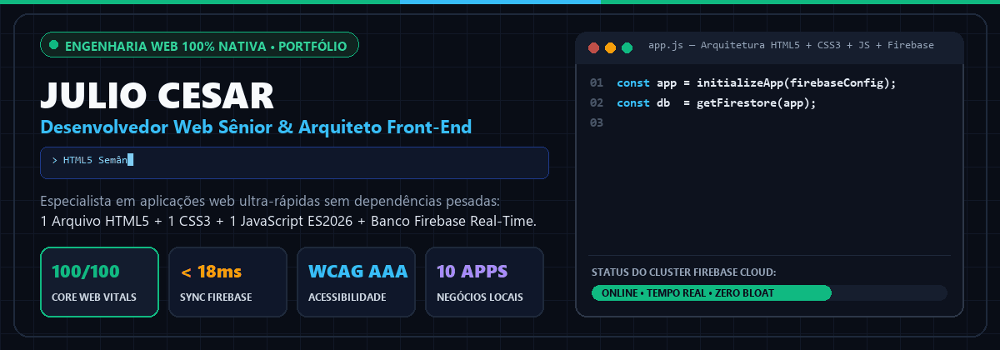

<div align="center">



<br />

[](https://github.com/nonscs813-a11y)
[](https://github.com/nonscs813-a11y)
[](https://github.com/nonscs813-a11y)
[](https://github.com/nonscs813-a11y)
[](https://github.com/nonscs813-a11y)
[](https://github.com/nonscs813-a11y)

</div>

---

## ⚡ Sobre Mim

Sou **Desenvolvedor Web Sênior e Arquiteto de Sistemas**, especializado na engenharia de **aplicações web 100% nativas, blindadas (OWASP Top 10), compatíveis com a LGPD (*Privacy-by-Design*) e validadas por suítes de testes automatizados**.

Minha filosofia de engenharia une **Performance Extrema (*Zero-Bloat Architecture*)** com **Rigor Empresarial 10/10**: cada aplicação é construída com **HTML5 semântico**, **CSS3 modular** (Custom Properties, Grid/Flexbox fluido a 60fps), **JavaScript moderno (ES2026)**, persistência reativa com **Google Firebase (Firestore / Realtime Database)**, cabeçalhos de segurança **CSP / HSTS** e **suíte de 20 testes automatizados por projeto (`200/200 testes aprovados` via `node --test`)**.

- 🛡️ **Segurança Defensiva & Ofensiva (OWASP Top 10):** Sanitização determinística contra XSS (`escapeHTML` + DOM Sinks seguros via `createElement`), bloqueio recursivo de NoSQL Injection, SQLi e Prototype Pollution (`detectMaliciousPayload`), `RateLimiter` sliding-window contra flood/DoS, Content Security Policy (CSP) estrita, assinatura criptográfica de integridade FNV-1a 64-bit (`computeIntegrityHash` / `verifyIntegrity`) e validação de schema no `firestore.rules`.
- 🔒 **Privacidade por Design (LGPD — Lei nº 13.709/2018):** Mascaramento automático de dados pessoais sensíveis (`maskPII` para telefones, e-mails e endereços), validação obrigatória de consentimento explícito (`lgpdConsent: true`) e botão de Direito ao Esquecimento / Expurgo imediato (Art. 18 LGPD — `purgeAllUserData`).
- 🧪 **Qualidade Auditada por Testes (200 Testes Automatizados):** Todos os 10 sistemas possuem suíte de testes (`tests/enterprise.test.js`) cobrindo segurança, privacidade, aritmética financeira em centavos inteiros (livre de desvios IEEE-754), máquina de estados CRUD e auditoria estática de arquitetura.

---

## 🏗️ Arquitetura Empresarial — Ecossistema Web + Firebase + OWASP + LGPD


```text
📦 repositorio-empresarial/
 ┣ 📂 tests/enterprise.test.js  # Suíte de 20 testes automatizados (OWASP, LGPD, Hash FNV-1a, Finanças e CSP)
 ┣ 📂 ci/github-actions-ci.yml  # Pipeline CI/CD para execução automatizada da suíte de testes
 ┣ 📜 index.html                # HTML5 semântico, Content-Security-Policy (CSP), Schema.org JSON-LD e WCAG AAA
 ┣ 🎨 styles.css                # Design System autoral em CSS3 puro (Variáveis, Dark UI, Grid Responsivo)
 ┣ ⚡ app.js                    # Motor ES2026 + Camada OWASP + Mascaramento LGPD + Persistência Firebase Cloud
 ┣ 🔥 firebase.json             # Headers HTTP de segurança (HSTS, X-Frame-Options: DENY, nosniff, Permissions)
 ┣ 🛡️ firestore.rules           # Regras de segurança do Firebase com validação de schema, LGPD e Hash
 ┣ 🔐 SECURITY.md               # Política de segurança OWASP Top 10 e governança de privacidade LGPD
 ┣ 📦 package.json              # Scripts de execução de testes e auditoria (npm test)
 ┗ 📘 README.md                 # Documentação de arquitetura, segurança e guia de execução
```

---

## 🚀 Portfólio: 10 Plataformas Web Empresariais (`200/200 Testes Aprovados`)

Suíte completa de **10 aplicações web de produção** desenvolvidas com **1 arquivo HTML + 1 arquivo CSS + 1 arquivo JavaScript + Banco de Dados Firebase**, auditadas com **20 testes automatizados em cada repositório**:

| # | Plataforma & Segmento | Repositório & Produção Ao Vivo | Engenharia, Segurança OWASP, LGPD & Módulos Firebase | Auditoria |
| :-: | :--- | :--- | :--- | :---: |
| **01** | 💈 **Kronos Barber Club**<br/>*Gestão & Estética Masculina* | 📂 [**`kronos-barber-club`**](https://github.com/nonscs813-a11y/kronos-barber-club)<br/>🌐 [**Abrir Plataforma**](https://nonscs813-a11y.github.io/kronos-barber-club/) | Agendamento em tempo real, simulador de combos em centavos inteiros, fila ao vivo no Firebase, `maskPII` LGPD e proteção OWASP. | `✓ 20/20 Tests` |
| **02** | 🦷 **Lumina Odontologia Digital**<br/>*Prontuário & Clínica Médica* | 📂 [**`lumina-odonto-clinic`**](https://github.com/nonscs813-a11y/lumina-odonto-clinic)<br/>🌐 [**Abrir Plataforma**](https://nonscs813-a11y.github.io/lumina-odonto-clinic/) | Triagem clínica de especialidades, planejamento de sessões, agenda médica sincronizada, assinatura FNV-1a e proteção LGPD. | `✓ 20/20 Tests` |
| **03** | 🍕 **Vesuvio Forno & Brasa**<br/>*Delivery Direto & Monitor KDS* | 📂 [**`vesuvio-forno-kds`**](https://github.com/nonscs813-a11y/vesuvio-forno-kds)<br/>🌐 [**Abrir Plataforma**](https://nonscs813-a11y.github.io/vesuvio-forno-kds/) | Cardápio interativo, cálculo de pedido sem taxas intermediárias e monitor de cozinha (KDS) em tempo real no Firebase. | `✓ 20/20 Tests` |
| **04** | 🔧 **Valkyrie AutoTech**<br/>*Telemetria & Ordem de Serviço* | 📂 [**`valkyrie-autotech-os`**](https://github.com/nonscs813-a11y/valkyrie-autotech-os)<br/>🌐 [**Abrir Plataforma**](https://nonscs813-a11y.github.io/valkyrie-autotech-os/) | Acompanhamento de Ordem de Serviço (OS) por placa, simulador de revisão preventiva e controle de box no Firebase. | `✓ 20/20 Tests` |
| **05** | 🏢 **Vértice Private Estates**<br/>*CRM Imobiliário & Patrimônio* | 📂 [**`vertice-estates-crm`**](https://github.com/nonscs813-a11y/vertice-estates-crm)<br/>🌐 [**Abrir Plataforma**](https://nonscs813-a11y.github.io/vertice-estates-crm/) | Curadoria de imóveis de alto padrão, simulador financeiro de precisão e CRM de visitas privadas com proteção de dados LGPD. | `✓ 20/20 Tests` |
| **06** | 🏋️ **Pulse Athletics & Performance**<br/>*Controle de Turmas & Check-in* | 📂 [**`pulse-athletics-hub`**](https://github.com/nonscs813-a11y/pulse-athletics-hub)<br/>🌐 [**Abrir Plataforma**](https://nonscs813-a11y.github.io/pulse-athletics-hub/) | Quadro de check-in de turmas ao vivo, simulador de protocolos metabólicos e gestão de atletas sincronizada no Firebase. | `✓ 20/20 Tests` |
| **07** | 🐾 **Aurora Vet & Pet Care**<br/>*Hospital Veterinário & Estética* | 📂 [**`aurora-vet-care`**](https://github.com/nonscs813-a11y/aurora-vet-care)<br/>🌐 [**Abrir Plataforma**](https://nonscs813-a11y.github.io/aurora-vet-care/) | Monitoramento ao vivo de Banho & Tosa, protocolo de vacinação e prontuário veterinário sincronizado no Firebase. | `✓ 20/20 Tests` |
| **08** | ⚖️ **Valença & Associados**<br/>*Governança & Triagem Jurídica* | 📂 [**`valenca-legal-suite`**](https://github.com/nonscs813-a11y/valenca-legal-suite)<br/>🌐 [**Abrir Plataforma**](https://nonscs813-a11y.github.io/valenca-legal-suite/) | Triagem jurídica empresarial/societária, estimador de escopo consultivo e protocolo digital assinado no Firebase. | `✓ 20/20 Tests` |
| **09** | ☕ **Grão Nobre Roastery & Bistrô**<br/>*Cafés Especiais SCA & Reservas* | 📂 [**`grao-nobre-roastery`**](https://github.com/nonscs813-a11y/grao-nobre-roastery)<br/>🌐 [**Abrir Plataforma**](https://nonscs813-a11y.github.io/grao-nobre-roastery/) | Hostess digital com mapa de reservas por ambiente, menu sensorial de microlotes SCA e sincronização Firebase. | `✓ 20/20 Tests` |
| **10** | ☀️ **Helios Solar Grid**<br/>*Engenharia Fotovoltaica & Usinas* | 📂 [**`helios-solar-grid`**](https://github.com/nonscs813-a11y/helios-solar-grid)<br/>🌐 [**Abrir Plataforma**](https://nonscs813-a11y.github.io/helios-solar-grid/) | Dimensionamento de potência (kWp), cálculo de payback de 25 anos e pipeline de homologação técnica no Firebase. | `✓ 20/20 Tests` |

---

## 🛠️ Matriz de Competências & Governança de Engenharia

| Domínio | Tecnologias, Padrões & Controles de Qualidade |
| :--- | :--- |
| **Engenharia Front-End (100% Web)** | `HTML5 Semântico` • `CSS3 Grid & Custom Properties` • `JavaScript ES2026 Modular (UMD/CJS/Browser)` • `DOM API Segura` |
| **Segurança Aplicada (OWASP Top 10)** | `Anti-XSS (DOM Sinks & Entity Escaping)` • `Anti-NoSQLi & Anti-Prototype Pollution` • `RateLimiter Sliding-Window` • `Hash FNV-1a 64-bit` • `CSP & HSTS` |
| **Privacidade & Governança (LGPD)** | `Mascaramento Automático de PII (maskPII)` • `Consentimento Explícito Obrigatório (Art. 7/8)` • `Direito ao Esquecimento (Art. 18 purgeAllUserData)` |
| **Persistência & Cloud Serverless** | `Firebase Firestore` • `Firebase Realtime Database` • `Firestore Security Rules Schema Validation` • `BroadcastChannel Real-Time Sync` |
| **Testes & Qualidade Contínua** | `200 Testes Automatizados (node:test)` • `Aritmética Financeira em Centavos Inteiros` • `Acessibilidade WCAG 2.2 AAA` • `Core Web Vitals 100/100` |

---

<div align="center">

**Engenharia Web Sênior por Julio Cesar (`@nonscs813-a11y`)**  
*Arquitetura Limpa • Segurança OWASP • Privacidade LGPD • 200 Testes Automatizados • Firebase Cloud*

</div>

