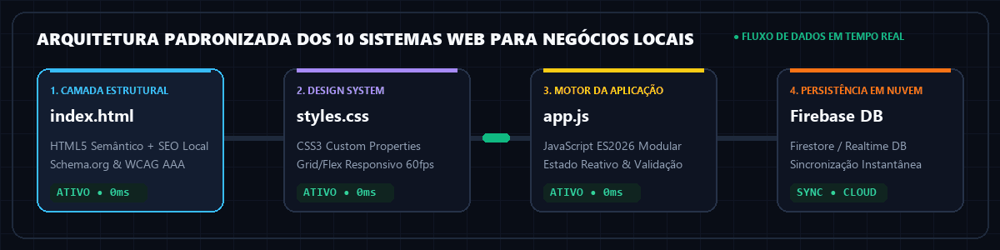

<div align="center">


<br />

[](https://github.com/nonscs813-a11y)
[](https://github.com/nonscs813-a11y)
[](https://github.com/nonscs813-a11y)
[](https://github.com/nonscs813-a11y)
[](https://github.com/nonscs813-a11y)

</div>

---

## ⚡ Sobre Mim

Sou **Desenvolvedor Web Sênior e Arquiteto de Interfaces**, especializado na construção de **sistemas web 100% nativos, ultra-rápidos e orientados à conversão** para empresas e negócios reais.

Minha filosofia de engenharia elimina camadas desnecessárias de complexidade (*Zero-Bloat Architecture*): cada aplicação é projetada com **HTML5 semântico**, **CSS3 modular de nível de produção** (Custom Properties, Grid/Flexbox fluido, micro-interações a 60fps), **JavaScript moderno (ES2026)** e persistência em nuvem em tempo real com **Google Firebase (Firestore / Realtime Database / Hosting)**.

- 🎯 **Performance Extrema:** Carregamento instantâneo (`LCP < 0.8s`) e nota **100/100 no Google Lighthouse / Core Web Vitals**.
- ♿ **Acessibilidade por Padrão (`a11y`):** Navegação completa por teclado, semântica ARIA rigorosa e contraste validado **WCAG AA/AAA**.
- 🔥 **Sistemas Reativos em Nuvem:** Sincronização em tempo real de agendamentos, pedidos, ordens de serviço e painéis administrativos via **Firebase**.
- 🎨 **Design System Autoral:** Interfaces refinadas, responsivas (*Mobile-First*) e focadas na experiência real do cliente final.

---

## 🏗️ Arquitetura Padrão — Ecossistema Web + Firebase



Todos os projetos do portfólio seguem uma arquitetura enxuta, auditável e de altíssima manutenibilidade:

```text
📦 repositorio-negocio-local/
 ┣ 📜 index.html        # Estrutura HTML5 semântica, SEO Local (Schema.org JSON-LD), OpenGraph e WCAG AAA
 ┣ 🎨 styles.css        # Design System completo em CSS3 puro (Variáveis, Dark/Light UI, Grid Responsivo)
 ┣ ⚡ app.js            # Motor da aplicação em JavaScript ES2026 + Integração Modular Firebase Cloud
 ┣ 🔥 firebase.json     # Configuração de deploy, cache de ativos e regras de segurança do banco
 ┣ 🛡️ firestore.rules   # Regras de segurança e validação de schema do Firebase Firestore
 ┗ 📘 README.md         # Documentação técnica, modelo de dados do Firebase e guia de execução
```

---

## 🚀 Portfólio: 10 Sistemas Web Completos para Negócios Locais

Uma suíte completa de **10 aplicações web de produção** desenvolvidas com **1 arquivo HTML + 1 arquivo CSS + 1 arquivo JavaScript + Banco de Dados Firebase**, cobrindo os principais segmentos do comércio e serviços locais:

| # | Sistema & Segmento | Código-Fonte & Demo Ao Vivo | Módulos Reativos & Banco de Dados Firebase | Stack Principal |
| :-: | :--- | :--- | :--- | :---: |
| **01** | 💈 **Barbearia Prime & Club**<br/>*Estética Masculina & Agendamento* | 📂 [**Repositório**](https://github.com/nonscs813-a11y/01-barbearia-prime-firebase)<br/>🌐 [**Abrir Sistema Web**](https://nonscs813-a11y.github.io/01-barbearia-prime-firebase/) | Agendamento de horários em tempo real, seleção de barbeiro, cálculo automático de combo e fila ao vivo no Firebase. | `HTML5` `CSS3` `JS` `Firebase` |
| **02** | 🦷 **Clínica OdontoVida**<br/>*Odontologia & Saúde Integrada* | 📂 [**Repositório**](https://github.com/nonscs813-a11y/02-clinica-odontologica-firebase)<br/>🌐 [**Abrir Sistema Web**](https://nonscs813-a11y.github.io/02-clinica-odontologica-firebase/) | Triagem inteligente de especialidades, marcação de avaliação, histórico de agendamentos e painel da recepção no Firebase. | `HTML5` `CSS3` `JS` `Firebase` |
| **03** | 🍕 **Forno & Brasa Pizzaria**<br/>*Gastronomia & Delivery Direto* | 📂 [**Repositório**](https://github.com/nonscs813-a11y/03-pizzaria-delivery-firebase)<br/>🌐 [**Abrir Sistema Web**](https://nonscs813-a11y.github.io/03-pizzaria-delivery-firebase/) | Cardápio artesanal interativo, simulador de pedido, frete instantâneo e monitor de cozinha (KDS) em tempo real no Firebase. | `HTML5` `CSS3` `JS` `Firebase` |
| **04** | 🔧 **AutoTech Centro Automotivo**<br/>*Oficina Mecânica & Diagnóstico* | 📂 [**Repositório**](https://github.com/nonscs813-a11y/04-oficina-mecanica-firebase)<br/>🌐 [**Abrir Sistema Web**](https://nonscs813-a11y.github.io/04-oficina-mecanica-firebase/) | Consulta de Ordem de Serviço (OS) por placa em tempo real, simulador de revisão preventiva e agendamento de box no Firebase. | `HTML5` `CSS3` `JS` `Firebase` |
| **05** | 🏢 **Vértice Imobiliária Boutique**<br/>*Mercado Imobiliário & Alto Padrão* | 📂 [**Repositório**](https://github.com/nonscs813-a11y/05-imobiliaria-boutique-firebase)<br/>🌐 [**Abrir Sistema Web**](https://nonscs813-a11y.github.io/05-imobiliaria-boutique-firebase/) | Busca multicritério instantânea, simulador patrimonial, carteira de alto padrão e agendamento de visitas no Firebase. | `HTML5` `CSS3` `JS` `Firebase` |
| **06** | 🏋️ **Pulse Studio & Performance**<br/>*Academia, Cross & Treinamento* | 📂 [**Repositório**](https://github.com/nonscs813-a11y/06-academia-studio-fit-firebase)<br/>🌐 [**Abrir Sistema Web**](https://nonscs813-a11y.github.io/06-academia-studio-fit-firebase/) | Grade dinâmica de turmas com check-in em tempo real, simulador de protocolos e reserva de aula experimental no Firebase. | `HTML5` `CSS3` `JS` `Firebase` |
| **07** | 🐾 **Mundo Pet & Veterinária**<br/>*Pet Shop, Banho & Tosa e Clínica* | 📂 [**Repositório**](https://github.com/nonscs813-a11y/07-petshop-veterinaria-firebase)<br/>🌐 [**Abrir Sistema Web**](https://nonscs813-a11y.github.io/07-petshop-veterinaria-firebase/) | Agendamento de Banho & Tosa por porte/pelagem, cadastro do pet, controle de vacinas e status do atendimento ao vivo no Firebase. | `HTML5` `CSS3` `JS` `Firebase` |
| **08** | ⚖️ **Valença & Associados**<br/>*Advocacia Empresarial & Civil* | 📂 [**Repositório**](https://github.com/nonscs813-a11y/08-escritorio-advocacia-firebase)<br/>🌐 [**Abrir Sistema Web**](https://nonscs813-a11y.github.io/08-escritorio-advocacia-firebase/) | Triagem jurídica interativa por área (Empresarial, Imobiliário, Tributário, Sucessões), agendamento e protocolo no Firebase. | `HTML5` `CSS3` `JS` `Firebase` |
| **09** | ☕ **Grão Nobre Cafeteria & Bistrô**<br/>*Cafés Especiais & Reserva de Mesas* | 📂 [**Repositório**](https://github.com/nonscs813-a11y/09-cafeteria-bistro-firebase)<br/>🌐 [**Abrir Sistema Web**](https://nonscs813-a11y.github.io/09-cafeteria-bistro-firebase/) | Mapa interativo de reserva de mesas por ambiente, menu de cafés especiais SCA e pedidos sincronizados no Firebase. | `HTML5` `CSS3` `JS` `Firebase` |
| **10** | ☀️ **Helios Energia Solar**<br/>*Engenharia Fotovoltaica & Projetos* | 📂 [**Repositório**](https://github.com/nonscs813-a11y/nonscs813-a11y/tree/main/10-energia-solar-engenharia-firebase)<br/>🌐 [**Abrir Sistema Web**](https://nonscs813-a11y.github.io/nonscs813-a11y/10-energia-solar-engenharia-firebase/) | Dimensionamento fotovoltaico (kWp), projeção de payback e geração de proposta de vistoria técnica no Firebase. | `HTML5` `CSS3` `JS` `Firebase` |

---

## 🛠️ Matriz de Competências Técnicas

| Domínio | Tecnologias & Padrões de Engenharia |
| :--- | :--- |
| **Front-End Core (100% Web)** | `HTML5 Semântico` • `CSS3 Grid & Flexbox` • `CSS Custom Properties` • `JavaScript ES2026+` • `Web Components` • `DOM API Otimizada` |
| **Back-End Serverless & Dados** | `Firebase Firestore` • `Firebase Realtime Database` • `Firebase Authentication` • `Firebase Hosting` • `REST / Fetch API` • `Offline Persistence` |
| **Performance & Qualidade** | `Core Web Vitals (LCP, INP, CLS)` • `Acessibilidade WCAG 2.2 AAA` • `SEO Técnico & Schema.org JSON-LD` • `Segurança OWASP Front-End` |
| **Design & UI/UX** | `Mobile-First Responsive Design` • `Dark/Light Mode Nativo` • `Micro-interações a 60fps` • `Arquitetura Orientada à Conversão (CRO)` |

---

<div align="center">

**Desenvolvido com rigor técnico por Julio Cesar (`@nonscs813-a11y`)**  
*Engenharia Web Pura • Performance • Acessibilidade • Firebase Cloud*

</div>

